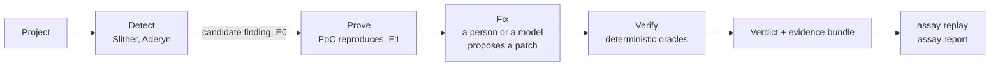
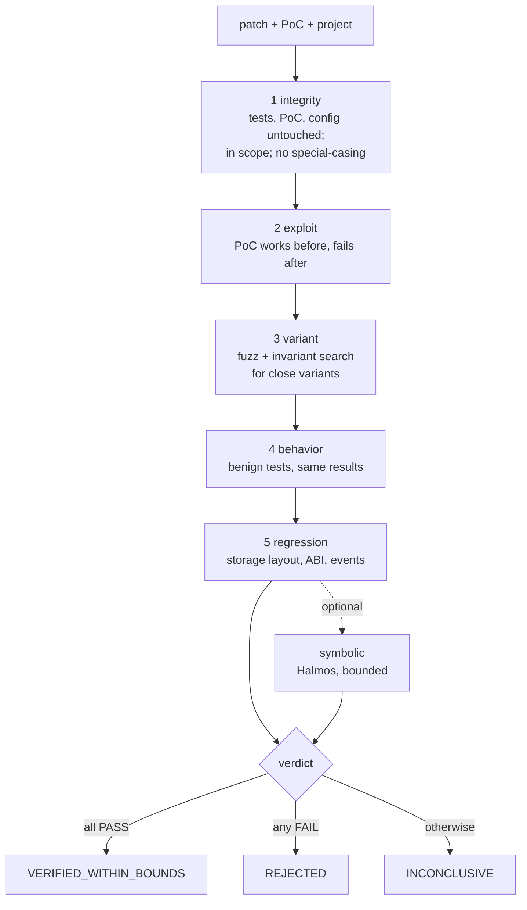

# Assay

Assay checks whether a patch for a Solidity vulnerability actually closes it, or only passes the
tests that already existed.

## The problem

A patch that makes the test suite pass is not necessarily a fix. It can stop the exact exploit
that was reported and leave a close variant open (the same attack with another amount, caller or
call order). It can switch off the behavior the contract exists for. It can close the hole and
change storage layout, ABI or events so that deployed state or integrations break. Tests written
before the bug know about none of these, and a reviewer reading the diff can miss them. Assay runs
the exploit, a bounded search for variants, the benign tests and an interface comparison against
the patched code, in a sandbox, and says which of those cases it found. It is built on
[Foundry](https://book.getfoundry.sh/) and it judges patches; it does not look for new bugs.

## Demo

You need [uv](https://docs.astral.sh/uv/), GNU Make and Docker; see [Install](#install). Build the
runner image once, then:

```sh
make demo-overfit   # about half a minute
make demo           # one to three minutes
```

The times are from an otherwise idle development machine; on a busy machine or under emulation
both take several times longer.

`make demo-overfit` verifies a patch that stops the original exploit and passes all the benign
tests, and shows the variant search defeating it:

```
oracle      verdict  reason
integrity   PASS     -
exploit     PASS     -
variant     FAIL     variant_found
behavior    PASS     -
regression  PASS     -

final verdict: REJECTED
reason: variant_found
```

The test that reproduces the variant ships in the evidence bundle and runs with plain Foundry.
`make demo` runs the whole flow (scan, prove, fix, verify, bundle, report) offline from recorded
answers instead of a model: the first patch is rejected, the second ends in
`VERIFIED_WITHIN_BOUNDS`. The answers are synthetic and no model wrote them; see
[the demo page](docs/demo.md).


## Install

Requirements: [uv](https://docs.astral.sh/uv/) (Python 3.12 is installed from `.python-version`),
GNU Make and Docker (Docker Desktop or Docker Engine). There is no release yet, so install from a
clone:

```sh
git clone https://github.com/sellebeww/assay-evm.git assay && cd assay
make install      # uv sync: the project and the development tools
make image        # build the runner image from docker/runner/versions.lock (needs network, once)
uv run assay doctor
```

`assay doctor` checks the Docker daemon, the runner image and the tool versions it declares
against `versions.lock`, the platform (native or emulated), disk space, and whether the model
variables are set. Everything after `make image` runs without network access.

A built image is not distributed. It is built locally from the pinned Dockerfile.

## Quickstart

Verify a patch (a unified diff) against a PoC on a project, and keep the evidence:

```sh
uv run assay verify --base fixtures/reentrancy/single_function \
  --patch fixtures/reentrancy/single_function/patches/good.diff \
  --poc fixtures/reentrancy/single_function/poc --bundle-out out/good
uv run assay replay out/good                       # re-check the bundle offline
uv run assay report out/good --out out/good.html   # one HTML file, no JavaScript
```

Find candidate findings, reproduce one, and let a model propose patches (replay mode answers from
cassettes and needs no key; `record` and `live` modes need `--allow-llm`, see
[the LLM layer](docs/llm.md)):

```sh
uv run assay scan fixtures/reentrancy/single_function --format sarif --out scan.sarif
uv run assay run fixtures/reentrancy/single_function --class reentrancy \
  --cassette-dir demo/cassettes --profile quick --bundle-out out/run
```

Every command has `--help` with an example, and `scan`, `verify`, `prove`, `fix`, `run`,
`replay` and `doctor` print stable JSON with `--json`. See [the command line reference](docs/cli.md)
for the commands, exit codes and JSON schemas.

## Continuous integration

<!-- claim: ci-safety -->

A composite GitHub Action verifies the Solidity changes of a pull request against the PoCs of a
project, without a model and without any secret:

```yaml
- uses: sellebeww/assay-evm@main
  with:
    poc-dir: poc
```

It writes a verdict table to the job summary, uploads the evidence bundles as an artifact, can
keep one pull request comment up to date (same-repository pull requests only) and fails the job
by a policy. The same check runs locally as `assay ci verify`. Never use it with
`pull_request_target`. See [the GitHub Action page](docs/github-action.md) and the example in
[`examples/demo-project`](examples/demo-project/README.md).

## How it works



The model, if one is used, appears only in Prove and Fix, as a proposer. Only the oracles in
Verify change a status.



| Oracle | Checks |
|---|---|
| Integrity | Tests, PoC and configuration are untouched; the patch stays in scope and contains no special-casing, binary files or symlinks. |
| Exploit | The PoC reproduces on the vulnerable revision and no longer reproduces on the patched one. |
| Variant | A fuzzing and invariant search for close variants of the exploit finds none on the patched revision. A variant counts only after a generated test reproduced it three times. |
| Behavior | The benign tests pass with the same recorded results as before. |
| Regression | Storage layout, ABI and events have no breaking change. |
| Symbolic (optional, `--symbolic`) | Halmos finds no counterexample within stated loop and calldata bounds. |

<!-- claim: ledger-promotion --> <!-- claim: ledger-audit -->
The ledger is a local SQLite database. A claim becomes `trusted` or `refuted` only through an
oracle run with a matching verdict, and database triggers enforce it. A timeout, an unknown result
or replays that disagree are `INCONCLUSIVE`, never a pass. Design and decisions:
[the design](docs/design.md) and the [ADRs](docs/adr/).

## What a verdict means

<!-- claim: verdict-meaning -->

`VERIFIED_WITHIN_BOUNDS` means that every required oracle passed and that no variant of the
exploit was found within the bounds that ran. **It is not a proof that the patch is correct or
that the code is free of vulnerabilities.** The bounds (seeds, runs, depth, time, and symbolic
loop and calldata limits) are printed with every verdict and recorded in the bundle.

| Verdict | Meaning |
|---|---|
| `VERIFIED_WITHIN_BOUNDS` | All required oracles passed; nothing was found within the recorded bounds. |
| `REJECTED` | At least one oracle failed. The reasons say which check and why. |
| `INCONCLUSIVE` | No oracle failed, but one was inconclusive or did not run (timeout, out of memory, unknown, flaky replay). |

| Evidence level | Meaning | Reached by |
|---|---|---|
| E0 | Unverified signal | Static analyzer output or a model hypothesis. |
| E1 | Exploit reproduced on the vulnerable revision | The PoC runs and three replays agree. |
| E2 | The patch blocks the PoC without a detected regression | Integrity, exploit, behavior and regression passed; the variant search did not decide. |
| E3 | All required oracles passed within the recorded bounds | The verdict `VERIFIED_WITHIN_BOUNDS`. |

A symbolic result does not create a level. It adds a statement such as "no counterexample within
loop bound 3" to the bounds.

## Measured results

Every result below comes from synthetic fixtures (one per class: reentrancy, access control,
unchecked call, signature replay, delegatecall, oracle manipulation, denial of service, rounding),
written by the same author as the oracles. They validate the tool against its own labels. They are
not an independent benchmark and say nothing about detection rates on real code. Each page comes
from one run and records the tool versions and the `versions.lock` hash it used; the pages were not
all produced from the same `versions.lock`.

<!-- claim: benchmark -->
- **Benchmark.** The protocol ([bench/PROTOCOL.md](bench/PROTOCOL.md)) was written before any
  held-out result existed. The oracles were frozen first (`bench/FROZEN_HASH`), then eight held-out
  fixtures with code shapes that differ from the development fixtures were written, without running
  the oracles on them, and then run. With the `standard` profile the verdicts of the full
  configuration equal the labels for 32 of 32 patches on the development split (95 % confidence
  interval 89.2 % to 100.0 %) and for 32 of 32 patches on the held-out split (95 % confidence
  interval 89.2 % to 100.0 %). The held-out cases were written by the same party as the oracles, so
  this is not an independent test, and the intervals are wide because the samples are small. On
  the held-out split, accepting a patch when only the tests pass accepts 16 of 24 bad patches
  (66.7 %, 95 % confidence interval 46.7 % to 82.1 %); adding the original PoC accepts the same 16
  of 24; adding the variant search accepts 8 of 24 (33.4 %, 17.9 % to 53.3 %); the full
  configuration accepts 0 of 24 (0.0 %, 0.0 % to 13.8 %) and rejects 0 of 8 good patches (0.0 %,
  0.0 % to 32.5 %). The fixtures are designed so that overfit and regressing patches pass the old
  tests, so the weaker configurations are expected to accept them. There was no mismatch between a
  verdict and a label, so the findings section is empty. [Results](docs/results.md).
<!-- claim: matrix -->
- **Classification matrix.** `assay verify` on the four labelled patches (good, overfit,
  destructive, regressing) of each fixture: 32 of 32 verdicts match the labels with the `standard`
  profile. The overfit patches were built to be reachable by the variant search, so this checks
  the labels, not the search on unseen patches. [Matrix](docs/classification-matrix.md).
<!-- claim: variant-power -->
- **Variant search power.** With both the `quick` and the `standard` profile the search found a
  variant for 8 of 8 overfit patches and none for the 8 good patches in that run. A smaller
  profile can miss a variant elsewhere. [Variant search power](docs/variant-power.md).
<!-- claim: static-coverage -->
- **Static analysis coverage.** Slither and Aderyn together report at least one finding mapped to
  the fixture's class for 6 of 8 fixtures. For oracle manipulation and rounding neither maps to
  the class. Findings are candidates, not reproductions. [Static coverage](docs/static-coverage.md).
<!-- claim: symbolic -->
- **Symbolic checks.** Four fixtures have properties. For access control, delegatecall and
  unchecked call, the overfit patches got a confirmed counterexample and no good patch did, within
  loop bound 3. For rounding, every run ran out of memory and ended `INCONCLUSIVE`. The other four
  classes have no properties. [Symbolic checks](docs/symbolic.md).
<!-- claim: model-untrusted -->
- **The model.** The fix loop is tested with synthetic cassettes in which the fixtures' own
  patches play the model. No live model has been evaluated, so how often a real model proposes a
  patch that passes is unknown.

## Security

<!-- claim: sandbox-isolation --> <!-- claim: sandbox-config --> <!-- claim: sandbox-ingest -->
Untrusted code (the project, its tests, the PoC, the patch, and the analyzer binaries themselves)
runs only inside a Docker container started by one component, the sandbox runner: no network, a
read-only root filesystem, dropped capabilities, a non-root user, memory, CPU, process and time
limits, one allowlisted command, no shell. The host never evaluates, unpickles or shells out with
data from a project, patch, tool or model. Ingest ignores a project's own Foundry configuration,
rejects inline configuration, symlinks out of the tree and path traversal, and applies patches
with its own parser. `make test-security` checks several of these properties against the real
image; [the sandbox page](docs/sandbox.md#security-claims) lists which are not covered yet.

<!-- claim: model-untrusted --> <!-- claim: redaction -->
A model is optional and untrusted. Its output is validated, a generated PoC passes a default-deny
static checker before it runs, and nothing it says can change a status. Code goes to a model
endpoint only with `--allow-llm`, after pattern-based redaction of keys, paths, user names and
similar; `--llm-dry-run` shows what would be sent. The API key lives only in the environment.
Redaction is pattern based and can miss an unusual secret.

<!-- claim: report-safety -->
Reports escape everything that comes from the project, patch or a model, and contain no
JavaScript. Details, tests and residual risks: [the threat model](docs/threat-model.md) and
[the runner sandbox](docs/sandbox.md). To report a vulnerability, see [SECURITY.md](SECURITY.md).

## Limits and non-goals

Read [the limitations](docs/limitations.md) before relying on a result. In short:

- Assay does not claim to find vulnerabilities in real contracts at any measured rate, and it never
  calls a contract or a patch secure, safe, proven or guaranteed. It is not a replacement for an
  audit.
- A bounded search cannot show absence. A variant outside the bounds can exist.
- Only the eight classes of the fixtures were measured, on small synthetic contracts.
- A container escape through a kernel or virtual machine flaw is outside what the sandbox can
  promise. An evidence bundle is tamper-evident, not a signature.
- It does not modify a repository, and there is no server, network API, dashboard or hosted
  service. There is no mainnet fork, RPC access or transaction broadcasting.
- Only the EVM, Solidity and Foundry project layouts are in scope.
- Early development: there is no release, and a final self-audit is still on the
  [roadmap](docs/roadmap.md).

## Development and contributing

```sh
make check             # lint, type check, unit tests and docs-check; needs no Docker
make test-integration  # tests against Docker and the runner image
make test-security     # sandbox security claims against the runner image
make demo              # offline demo; also make demo-overfit
```

See [CONTRIBUTING.md](CONTRIBUTING.md) for the rules (tests first, no weakened checks, an ADR for
a decision that deviates from an accepted one) and the [Code of Conduct](CODE_OF_CONDUCT.md).
The [changelog](CHANGELOG.md) lists changes.

## Documentation

- [Demo](docs/demo.md)
- [Command line reference, exit codes and JSON schemas](docs/cli.md)
- [GitHub Action and `assay ci verify`](docs/github-action.md)
- [Design](docs/design.md), [threat model](docs/threat-model.md) and [limitations](docs/limitations.md)
- [Oracles, `assay verify`, evidence bundles and `assay replay`](docs/oracles.md)
- [The LLM layer and `assay prove`](docs/llm.md)
- [The fix loop, `assay fix` and `assay run`](docs/fix-loop.md)
- [Static analysis and `assay scan`](docs/scan.md)
- [Runner sandbox](docs/sandbox.md)
- [Fixture specification](docs/fixture-spec.md)
- [Benchmark protocol](bench/PROTOCOL.md)
- Generated results: [benchmark results](docs/results.md),
  [classification matrix](docs/classification-matrix.md),
  [variant search power](docs/variant-power.md), [static coverage](docs/static-coverage.md),
  [symbolic checks](docs/symbolic.md)
- [Claims and evidence](docs/claims.md), [self-audit](docs/audit.md) and [third-party notices](THIRD_PARTY_NOTICES.md)
- [Roadmap](docs/roadmap.md) and [architecture decision records](docs/adr/)

## License

[MIT](LICENSE). The PyPI distribution is `assay-evm`; it provides the Python package `assay` and
the command `assay`.
