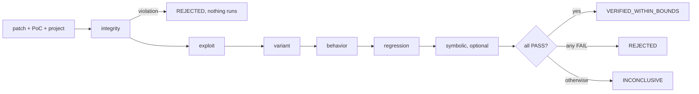

# Design

This page describes how Assay is built and why: the components, how data flows between them, where
trust changes, which invariants the ledger enforces, and the decisions behind them. Each decision
links to its [ADR](adr/). The threats are in [the threat model](threat-model.md) and the limits in
[limitations](limitations.md).

## The idea

Assay answers one question: given a Solidity project, a proof-of-concept (PoC) exploit and a
candidate patch, does the patch close the hole, or does it only pass the tests that existed before
([ADR 0002](adr/0002-verification-first.md))? It is a verification tool. Detection is left to
existing analyzers, and their output is treated as a hint.

The pipeline has four stages. Only the last one is the core.

| Stage | What happens | Result |
|---|---|---|
| Detect | Slither and Aderyn run in the sandbox; results are normalized and deduplicated. | Candidate findings, evidence level E0, `candidate (unverified)`. |
| Prove | A PoC reproduces the issue on the vulnerable revision. A model may write it. | `REPRODUCED`, evidence level E1. |
| Fix | A human or a model proposes a patch. | A diff. It has no status until it is verified. |
| Verify | Deterministic oracles judge the patch. | `VERIFIED_WITHIN_BOUNDS`, `REJECTED` or `INCONCLUSIVE`. |

The commands are `assay scan`, `assay prove`, `assay fix` (with `assay run` for the whole chain)
and `assay verify`. Every verification can be packaged as an evidence bundle that `assay replay`
re-checks offline and `assay report` renders as one HTML file.

## Components

```
                         untrusted                     |  trusted: Assay's own code
                                                       |
  target project  PoC  patch  analyzer output  model   |   ingest         snapshot, rewritten config,
  (code, tests,   (.sol) (.diff) (JSON)        replies |                  patch parser
   foundry.toml)                                       |   orchestrator   scan, prove, fix, verify
                                                       |   oracles        integrity, exploit, variant,
  --------------------- SandboxRunner ----------------+-                  behavior, regression,
  forge, Slither, Aderyn, Halmos in the runner image   |                  symbolic
  (no network, read-only root, no capabilities)        |   ledger         SQLite, blobs, audit chain
                                                       |   LLM layer      client, redaction, cassettes
                                                       |   report         bundle, replay, HTML
```

| Component | Source | Role |
|---|---|---|
| Ingest | `src/assay/ingest/` | Copies a project into a snapshot, hashes it, rejects symlinks out of the tree, path traversal, special files and inline Foundry configuration, writes a fixed `foundry.toml`, and applies patches with its own parser, never `git apply` ([ADR 0009](adr/0009-reject-inline-foundry-config.md), [ADR 0012](adr/0012-patches-that-cannot-be-applied.md)). |
| Sandbox runner | `src/assay/sandbox/` | The only way untrusted code runs: one allowlisted command per container, no shell ([sandbox](sandbox.md)). |
| Analyzers | `src/assay/analyzers/`, `src/assay/analysis/` | Adapters for Foundry, Slither and Aderyn; strict parsing, normalization, deduplication, SARIF ([ADR 0015](adr/0015-static-analyzers-in-the-runner-image.md), [ADR 0016](adr/0016-normalization-of-scan-findings.md)). |
| Oracles | `src/assay/oracles/` | Deterministic checks that return `PASS`, `FAIL` or `INCONCLUSIVE` with structured reasons ([oracles](oracles.md)). |
| Orchestrator | `src/assay/orchestrator/` | Runs scan, prove, fix and verify in order and records every step. |
| Ledger | `src/assay/ledger/` | SQLite system of record with content-addressed blobs and a hash-chained audit log ([ADR 0004](adr/0004-sqlite-content-addressed-blobs.md)). |
| LLM layer | `src/assay/llm/` | One OpenAI-compatible client, redaction, consent, budgets, cassettes, the hypothesis and PoC writer and the patcher ([the LLM layer](llm.md)). |
| Reports | `src/assay/report/` | Evidence bundle, replay and the HTML report ([ADR 0013](adr/0013-evidence-bundle-and-replay.md)). |
| CI | `src/assay/ci/`, `action.yml` | The diff of a pull request computed with git and checked, the `--fail-on` policy and the Markdown summary behind `assay ci verify`, and the composite GitHub Action ([GitHub Action](github-action.md), [ADR 0021](adr/0021-sandbox-image-in-github-actions.md)). |
| CLI | `src/assay/cli/` | Typer commands, exit codes and `--json` documents ([command line reference](cli.md)). |

The runner image holds forge, solc, forge-std, Slither, Aderyn and, in a second image built for
linux/amd64, Halmos. Every tool is pinned in `docker/runner/versions.lock`; "latest" is never
accepted ([ADR 0003](adr/0003-python-foundry-docker.md), [ADR 0018](adr/0018-halmos-in-a-linux-amd64-image.md)).

## The five oracles



| Oracle | Question | Does not show |
|---|---|---|
| Integrity | Do tests, PoC and configuration stay untouched? Is the patch inside its scope, free of binary files, symlinks, vacuous changes, special-casing and environment sniffing? | That the code is correct. |
| Exploit | Does the PoC reproduce on the vulnerable revision (three replays) and fail on the patched one? | That no other exploit exists. |
| Variant | Does a fuzz and invariant search find a close variant of the exploit on the patched revision? A variant counts only after a generated test (`variant_poc.t.sol`) reproduced it three times. | Absence of variants: the search is bounded by seeds, runs, depth and time. |
| Behavior | Do the benign tests pass, with the same recorded results as before? | Behavior no benign test exercises. |
| Regression | Are storage layout, ABI and events free of breaking changes? | Semantic changes behind an unchanged interface. |
| Symbolic (optional) | Does Halmos find a counterexample within loop and calldata bounds? | Correctness; paths past the bounds are cut. |

The final verdict is a function of the oracle verdicts and nothing else: `REJECTED` when any
oracle failed, `INCONCLUSIVE` when none failed but one was inconclusive or did not run, and
`VERIFIED_WITHIN_BOUNDS` only when all required oracles passed. A timeout, an out-of-memory kill, a
disagreeing replay or an unknown solver result is `INCONCLUSIVE`, never `PASS`
([ADR 0005](adr/0005-only-deterministic-oracles-promote-claims.md)). A report always carries the
bounds that ran, so a positive verdict says what it covers.

## Data flow

1. A project is ingested into a snapshot with a tree hash. A patch is parsed and applied to a copy.
2. Each oracle builds run trees (the project, a copy of the shared harness under `assay/`, and the
   PoC in place of the tests; [ADR 0011](adr/0011-run-trees-for-harness-and-poc.md)) and starts
   forge, or Halmos, in the sandbox. Only the sanitized output returns to the host.
3. The oracle reads forge's JSON, not its console text: a predicate counts only when the PoC
   contract itself emitted the harness event, so output printed by the target proves nothing.
4. Every oracle run is written to the ledger: argv, image id, seed, exit code, verdict, reasons and
   a trace blob.
5. The orchestrator computes the final verdict and bounds statement, and `assay verify
   --bundle-out` writes the bundle: base tree, PoC, harness, patch, the evidence of every oracle
   and a manifest with the sha256 of every file.
6. `assay replay` checks every hash first (a changed byte stops everything with exit code 5), then
   runs the oracles again and compares the verdicts with the manifest. `assay report` checks the
   same hashes and writes the HTML.

## Trust boundaries

| Boundary | Rule |
|---|---|
| Host and container | Untrusted code, including the analyzers, runs only through the sandbox runner: no network, read-only root, dropped capabilities, non-root user, resource limits. |
| Assay and project data | Everything from a project, patch, tool or model is data. The host never evals it, unpickles it or passes it to a shell. Strict Pydantic models validate it, with size caps. |
| Assay and a model endpoint | The model is optional and untrusted. Code leaves the machine only with `--allow-llm`, after redaction ([ADR 0006](adr/0006-llm-as-untrusted-proposer.md)). |
| Verdict and everything else | Only a deterministic oracle changes a status. A model run, an analyzer result or a human comment never does. |
| Report and viewer | Text from untrusted sources is escaped for its context; the page has no script and a restrictive content security policy. |

## Ledger invariants

The ledger enforces these twice, in application code and in SQLite triggers, so a raw `UPDATE`
from the `sqlite3` shell fails as well:

- A claim becomes `trusted` or `refuted` only through `promote_claim(claim_id, oracle_run_id)`,
  and only when that oracle run has the matching verdict.
- `oracle_run` rows are immutable: updates and deletes are rejected.
- `audit_log` is append-only and hash-chained; the chain walk reports the first violation.
- Finding states follow a fixed transition table; a transition caused by an oracle names the
  `oracle_run`. A `model_run` never causes one.
- Blobs are content-addressed, written once and verified on every read.
- Timestamps live in the ledger only, never in bundles or reports.

Property tests apply random operation sequences and check that none yields a `trusted` claim
without an oracle run. `assay dev ledger-audit` checks the global invariants of a database. The
chain is tamper-evident, not a signature: whoever can rewrite the whole database can rebuild it.

## Determinism

The same inputs give the same verdicts and the same manifest, except for the recorded durations.
Seeds are fixed and derived from one base seed; forge runs single-threaded so that fuzz results do
not depend on scheduling ([ADR 0014](adr/0014-single-threaded-forge-test-runs.md)); the tools are
pinned; output is normalized. Manifests, bundles and reports hold no timestamps, absolute host
paths or user names. Anything that is not reproducible is reported as such: two replays that
disagree make a result `INCONCLUSIVE` (`flaky_poc`, `flaky_counterexample`).

## Key decisions

| Decision | ADR |
|---|---|
| Verification first: Assay judges patches, it does not detect | [0002](adr/0002-verification-first.md) |
| Python, Foundry and Docker | [0003](adr/0003-python-foundry-docker.md) |
| SQLite ledger with content-addressed blobs | [0004](adr/0004-sqlite-content-addressed-blobs.md) |
| Only deterministic oracles promote claims | [0005](adr/0005-only-deterministic-oracles-promote-claims.md) |
| The language model is an untrusted proposer | [0006](adr/0006-llm-as-untrusted-proposer.md) |
| Phased delivery; no server, API or dashboard | [0007](adr/0007-phased-delivery-decisions.md) |
| Runner image built for the host platform | [0008](adr/0008-runner-platform.md) |
| Inline Foundry configuration is rejected at ingest | [0009](adr/0009-reject-inline-foundry-config.md) |
| Patch labels are mutually exclusive | [0010](adr/0010-mutually-exclusive-patch-labels.md) |
| Separate run trees for harness and PoC | [0011](adr/0011-run-trees-for-harness-and-poc.md) |
| Patches that cannot be applied end verification early | [0012](adr/0012-patches-that-cannot-be-applied.md) |
| Evidence bundle and replay environment | [0013](adr/0013-evidence-bundle-and-replay.md) |
| Single-threaded forge runs | [0014](adr/0014-single-threaded-forge-test-runs.md) |
| Static analyzers inside the runner image | [0015](adr/0015-static-analyzers-in-the-runner-image.md) |
| Normalization of scan findings | [0016](adr/0016-normalization-of-scan-findings.md) |
| Campaign profiles and confirmed variants | [0017](adr/0017-campaign-profiles-and-confirmed-variants.md) |
| Halmos in a linux/amd64 image | [0018](adr/0018-halmos-in-a-linux-amd64-image.md) |
| Fix loop in the ledger; held-out final decision | [0019](adr/0019-fix-loop-ledger-and-held-out-decision.md) |
| `assay doctor` matches the image by pinned versions | [0020](adr/0020-doctor-matches-the-image-by-pinned-versions.md) |

## Why these choices

- **The model only proposes.** A model can write a PoC or a patch faster than a person, and it can
  also be wrong or misled by text in the code it reads. Giving its output no authority keeps the
  verdict independent of its quality: a bad proposal wastes attempts and is rejected by the same
  oracles that reject a human's.
- **Several oracles instead of one.** Each of the four failure shapes of a patch (open variant,
  disabled behavior, changed interface, tampered tests) needs its own check. A single score would
  hide which one failed.
- **Bounded claims.** Fuzzing and symbolic execution cannot show absence. The verdict name
  (`VERIFIED_WITHIN_BOUNDS`) and the bounds statement in every output keep the claim as small as the
  evidence.
- **Local only.** There is no server, account or network API: the tool runs on one machine, which
  keeps the attack surface to the sandbox, the Docker daemon and the optional model endpoint.
